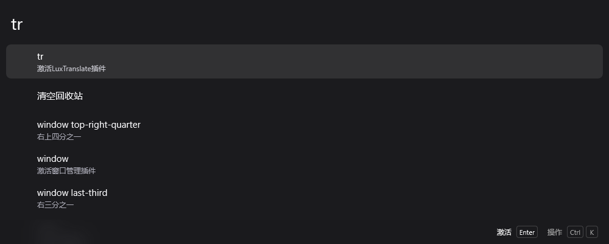
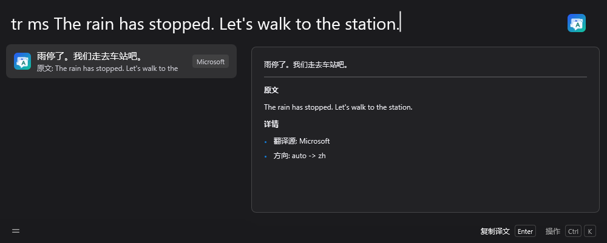

#  LuxTranslate

[中文](README.md) | [English](README.en.md)

> 插件目前仍是测试版，尚未充分测试。遇到严重 bug 先说声抱歉，欢迎通过 [GitHub Issues](https://github.com/stmluyuer/Wox.Plugin.LuxTranslate/issues) 反馈，我会尽快修复。

在 [Wox](https://github.com/Wox-launcher/Wox) 中输入 `tr` 和要翻译的文字，即可使用 LuxTranslate。插件根据 Wox 的界面语言和配对语言判断翻译方向；中文界面下，默认把中文译为英文，其他语言译为中文。也可以手动指定源语言和目标语言。

[下载测试版](https://github.com/stmluyuer/Wox.Plugin.LuxTranslate/releases/latest) · [反馈问题](https://github.com/stmluyuer/Wox.Plugin.LuxTranslate/issues)



Wox v2.4.7 + LuxTranslate v0.1.4 的 10 秒演示：输入两句相关的英文，查看 Microsoft 的实际中文译文，再切换到有道；两次译文均来自服务的真实返回。

<details>
<summary>查看翻译结果</summary>



结果预览显示中文译文、完整原文和翻译来源。

</details>

## 功能

- 输入 `tr <text>` 翻译，按回车复制译文。
- 用轻量识别判断中文/英文翻译方向。
- 同时查看多个翻译源的结果。
- 逐步显示大模型返回的译文，并提示不完整的响应。
- 缓存翻译历史；更换模型或接口后重新请求，也可用“重新翻译”跳过缓存。
- 按需显示或隐藏预览中的原文、翻译源和语言方向。
- 设置页按翻译源类型分组，API Key、Base URL 和模型可在表格行编辑中配置。

## 翻译源

可以使用免配置翻译源，也可以接入大模型：

| 类型       | 翻译源                                                |
| ---------- | ----------------------------------------------------- |
| 免配置翻译 | Microsoft、有道、彩云                                 |
| 大模型翻译 | OpenAI、Claude、DeepSeek、通用 OpenAI-compatible 接口 |

说明：

- Microsoft 使用免手动配置的接口，但该接口不是官方稳定 API，可能随时失效。
- 有道使用公开词典/翻译接口，适合轻量查询。
- 彩云使用网页翻译的 JWT 流程，先获取临时 JWT，再请求译文；当前实现只支持中文或英文目标语言。该流程适合轻量查询，不是供用户填写自有 API Token 的官方接口。
- OpenAI、DeepSeek 和通用大模型使用 OpenAI-compatible chat completions 格式。
- Claude 使用 Anthropic Messages API 格式。

## 安装

需要 **Wox 2.0.4 或更高版本**。在 Wox 的插件商店搜索 **LuxTranslate** 安装，也可以从 [GitHub Releases](https://github.com/stmluyuer/Wox.Plugin.LuxTranslate/releases/latest) 下载 `wox.plugin.luxtranslate.wox`，在 Wox 中打开安装。当前发布版为 [v0.1.4](https://github.com/stmluyuer/Wox.Plugin.LuxTranslate/releases/tag/v0.1.4)。

从源码构建（当前 `main` 分支版本为 0.1.5，设置页多选的 Wox 依赖见下方配置说明）：

```bash
git clone https://github.com/stmluyuer/Wox.Plugin.LuxTranslate.git
cd Wox.Plugin.LuxTranslate
pnpm install
pnpm build
```

构建产物位于 `dist/`。安装 Make 后可运行 `make package`，生成 `wox.plugin.luxtranslate.wox`；该命令会重新构建并在打包后清理 `dist/`。

## 使用

| 命令                | 说明                             |
| ------------------- | -------------------------------- |
| `tr hello`          | 使用已选来源，留空时使用默认来源 |
| `tr 你好`           | 自动翻译为英文                   |
| `tr ms hello`       | 强制使用 Microsoft               |
| `tr youdao hello`   | 强制使用有道                     |
| `tr caiyun hello`   | 强制使用彩云                     |
| `tr openai hello`   | 强制使用 OpenAI                  |
| `tr claude hello`   | 强制使用 Claude                  |
| `tr deepseek hello` | 强制使用 DeepSeek                |
| `tr custom hello`   | 强制使用通用大模型接口           |
| `tr ms en:ja hello` | 使用 Microsoft，英文翻译为日文   |
| `tr history`        | 查看最近翻译历史                 |
| `tr history hello`  | 搜索翻译历史                     |

### 使用小技巧

在 Wox 的“快捷查询”中，把快捷键绑定到 `tr {wox:selected_text}`。之后在任意应用中选中文字，按下这个快捷键即可翻译。

## 配置

发布版 v0.1.4 通过翻译窗口的“筛选”（`Ctrl+F`，macOS 为 `Cmd+F`）选择多个翻译源。

当前 `main` 分支的 0.1.5 开发版本新增设置页多选，与翻译窗口共用选择；设置页功能依赖 Wox 的多选修复（[PR #4644](https://github.com/Wox-launcher/Wox/pull/4644)，已合并）。使用时需确认 Wox 构建包含该修复，否则继续通过翻译窗口的“筛选”选择来源。0.1.5 发布前仍需将最低 Wox 版本调整为实际包含修复的发布版本。

- `默认翻译源`：没有选择翻译源时，普通 `tr <text>` 查询使用的来源。
- `翻译源（多选）`（0.1.5 开发版本）：设置页和翻译窗口的“筛选”（`Ctrl+F`，macOS 为 `Cmd+F`）共用同一份选择，修改后在下次查询时生效。留空时使用默认翻译源，也可通过“使用默认翻译源”操作清空选择。升级会保留原先实际使用的筛选选择，试用框里的选项不会覆盖它。
- `免配置翻译源`：管理 Microsoft、有道、彩云等无需手动 API Key 的翻译源。
- `大模型翻译源`：配置 OpenAI、Claude、DeepSeek 或通用大模型的 API Key、Base URL 和模型名。
- `历史记录条数`：默认保留 10 条翻译历史。
- `显示原文和服务详情`：控制预览中是否展示原文、provider 和语言方向。

结果菜单支持“重新翻译”和切换翻译源，都会保留原文及语言方向。选中文本入口将整段原文作为文字处理，保留换行和缩进；选中 `history` 等单词也会正常翻译。

## 开发

```bash
pnpm install
pnpm test
pnpm build
```

常用脚本：

- `pnpm test`：运行 Jest 测试。
- `pnpm build`：运行 lint、format、打包到 `dist/`。
- `pnpm run lint`：运行 ESLint。

## 截图


## AI 协作声明

本项目由作者在 OpenAI Codex 5.5 协助下大量生成、重构和测试。作者负责需求设计、代码审阅、功能验证和发布决策。

## License

MIT License. See [LICENSE](LICENSE).
